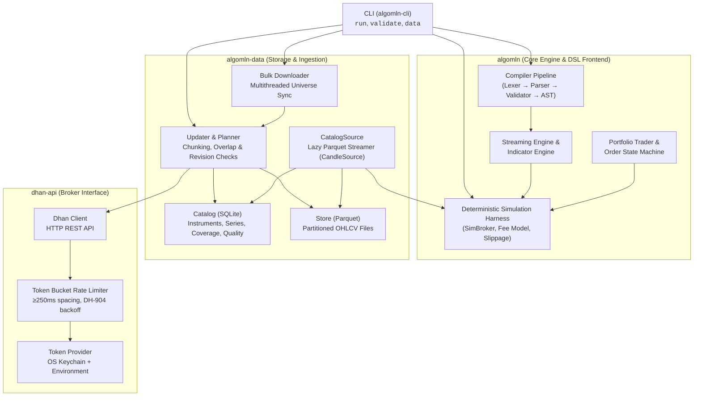
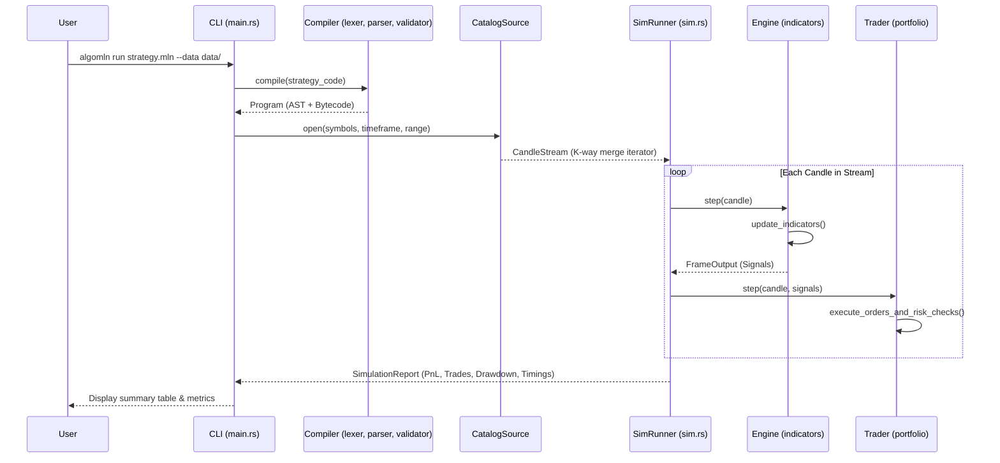
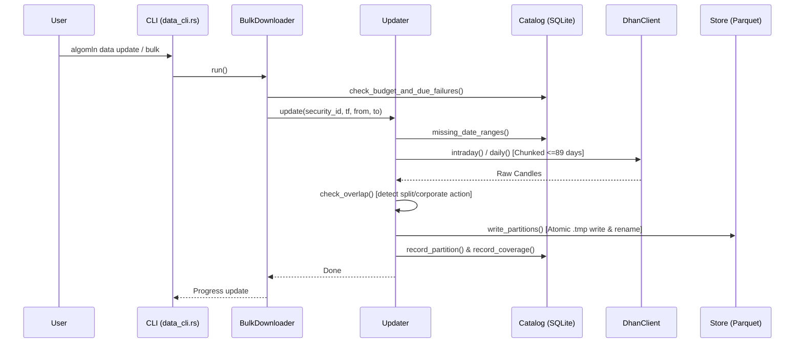

# AlgoMLN Architecture Map

AlgoMLN is an end-to-end algorithmic trading and quantitative backtesting system designed for high performance, strict determinism, and seamless market data ingestion for Indian equities and derivatives (NSE).

---

## 1. High-Level System Architecture



---

## 2. Workspace Crate Breakdown

The workspace consists of 4 main crates:

```
AlgoMLN/
├── src/            # algomln (Core Library)
├── data/           # algomln-data (Data Management & Simulation Source)
├── dhan-api/       # dhan-api (Dhan Broker REST Client & Limiter)
└── cli/            # algomln-cli (Unified Binary)
```

### 2.1. `algomln` (Core Engine)
The core library containing the Domain Specific Language (DSL) compiler, the streaming indicator calculation engine, the portfolio trader state machine, and the simulation runner.

- **`ast.rs`**: AST definitions for rules, actions (`BUY`, `SELL`, `EXIT`), indicators, expressions, and condition trees.
- **`lexer.rs`**: Hand-written lexical scanner with exact span reporting and Unicode support.
- **`parser.rs`**: Predictive recursive descent parser building validated syntax trees from tokens.
- **`validator.rs`**: Semantic analysis, indicator parameter bounds validation, rule consistency checks, and type checks.
- **`diagnostics.rs`**: Structured compiler error reporting with source line/column visual annotations.
- **`engine.rs`**: The strategy evaluation engine ([`Engine`](src/engine.rs)). Evaluates indicator values against rule conditions tick-by-tick.
- **`indicators/`**: Streaming, stateful technical indicators (`SMA`, `EMA`, `RSI`, `MACD`, `Bollinger Bands`, `ATR`, `Supertrend`, etc.) optimized for zero heap allocations per bar.
- **`trader/`**: Portfolio state machine ([`Trader`](src/trader.rs)). Manages cash reserves, order queues, fill tracking, stop-loss / take-profit conditions, and maximum daily drawdown halts.
- **`sim/`**: Deterministic simulation runtime ([`sim::run`](src/sim.rs)). Replays candle streams against an simulated exchange broker with realistic latency, half-even integer fee models, tick rounding, and adverse slippage.

---

### 2.2. `algomln-data` (Catalog, Store & Backfill)
A structured storage and cataloging layer for market historical data:

- **`types.rs`**: Timeframe definition (`1m`, `5m`, `15m`, `25m`, `60m`, `1d`), [`Bar`](data/src/types.rs), [`Instrument`](data/src/types.rs), [`Quality`](data/src/types.rs), and OHLCV sanity validators.
- **`catalog.rs`**: SQLite-backed metadata catalog tracking instrument master lists, series coverage ranges, session bar counts, trading calendar holidays, and data quality metrics.
- **`store.rs`**: Parquet file partitioner writing data partitioned by `candles/{security_id}/{tf}/{YYYY-MM}.parquet` using atomic file replacement and SHA-256 checksums.
- **`session.rs`**: Indian Standard Time (IST) calendar calculations, session duration classification (375-minute equity sessions vs 360-minute F&O sessions), regime shift detection, and overlap revision checks.
- **`history.rs`**: [`HistoryApi`](data/src/history.rs) trait decoupling network fetchers from catalog and storage logic.
- **`updater.rs`**: Incremental backfill updater ([`Updater`](data/src/updater.rs)). Calculates missing gaps via [`plan_requests`](data/src/updater.rs), splits requests into 89-day chunks, handles corporate action / split detection, and enforces daily API budgets.
- **`bulk.rs`**: High-throughput universe downloader ([`BulkDownloader`](data/src/bulk.rs)) supporting serial or worker-pool downloads with live ETA progress output and pause/resume capability.
- **`source.rs`**: [`CatalogSource`](data/src/source.rs), implementing [`CandleSource`](src/sim.rs). Streams verified Parquet partitions through a K-way heap merge for multi-symbol simulation with lazy single-partition resident memory bounds.

---

### 2.3. `dhan-api` (Broker Integration Edge)
HTTP interface to the Dhan Trading Open API:

- **Client (`DhanClient`)**: Low-level client for fetching intraday / daily historical OHLCV data and instrument scrip masters.
- **Authentication**: Pluggable [`TokenProvider`](dhan-api/src/lib.rs) querying the OS keychain (`keyring`) with fallback to `DHAN_ACCESS_TOKEN`.
- **Global Rate Limiter**: Shared client-side token bucket ensuring strict &ge;250ms spacing between request starts and automatic exponential backoff on `DH-904` rate limit responses.

---

### 2.4. `algomln-cli` (Command Line Tool)
The user-facing CLI binary:

- **`algomln run`**: Compiles strategy scripts, connects to data sources (CSV files or `CatalogSource`), runs deterministic backtests, and reports trade statistics, metrics, and wall timings.
- **`algomln validate`**: Statically analyzes strategy DSL code for syntax and semantic correctness.
- **`algomln data`**: Dispatches subcommands (`status`, `verify`, `update`, `import`, `bulk`) to maintain local historical market data caches.

---

## 3. Data Flow & Execution Lifecycles

### 3.1. Backtest Execution Flow



### 3.2. Data Ingestion & Backfill Flow



---

## 4. Key Architectural Invariants

1. **Bit-Identical Determinism**:
   Two simulation runs with the same strategy code, data source, and configuration produce identical trade sequences, fee calculations, and PnL metrics down to the integer paise.
2. **Crash-Safe Atomic Storage**:
   Parquet partitions are staged into temporary files (`*.parquet.tmp-*`) and committed via OS atomic renames (`MoveFileExW` with `MOVEFILE_REPLACE_EXISTING` on Windows; `rename` on POSIX).
3. **Lazy Memory Footprint**:
   `CatalogSource` guarantees that at most one Parquet partition per symbol is loaded into memory at any given time, preventing OOM when simulating multi-year universes.
4. **Resilient Rate Limiting**:
   The Dhan client rate limiter enforces &ge;250ms spacing between HTTP requests across all worker threads globally, while SQLite writes run under WAL mode with `busy_timeout` and `IMMEDIATE` transaction locking.
