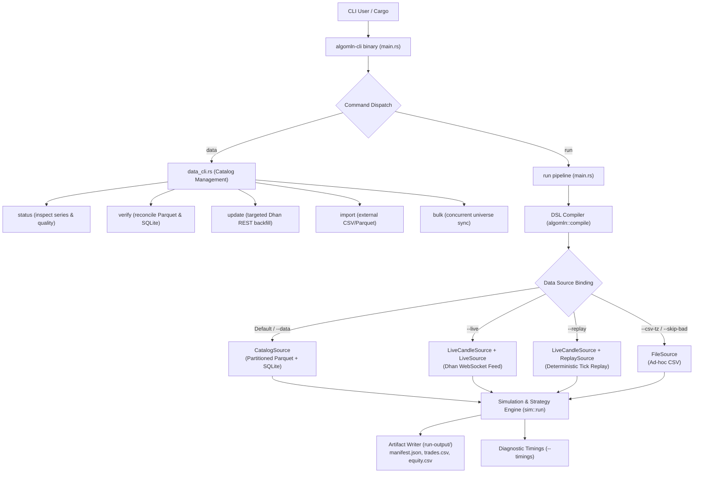

# AlgoMLN CLI Command Structure & Reference

This document provides a comprehensive reference for the `algomln` command-line interface, including CLI architecture, strategy execution modes (`algomln run`), market data catalog operations (`algomln data`), and authentication utilities.

---

## 1. CLI Architecture & Execution Pipeline

The `algomln-cli` crate serves as the unified entry point for both offline simulation and real-time execution. It orchestrates strategy compilation, data source binding, simulated trade execution, and market catalog maintenance.



### Workspace Crate Coordination
- **`algomln-cli`**: Dispatches CLI arguments, configures runtime pipelines, and handles signal interruptions.
- **`algomln`**: Compiles strategy DSL scripts into executable AST/bytecode, computes streaming technical indicators, and drives the deterministic portfolio trader and simulation harness.
- **`algomln-data`**: Manages the local SQLite catalog (`catalog.sqlite`), partitioned Parquet store, lazy multi-symbol streaming (`CatalogSource`), and real-time 1-minute candle synthesis (`LiveCandleSource`).
- **`dhan-api`**: Connects to the Dhan broker REST API for historical data downloads with rate limiting, and provides binary WebSocket decoding, tick recording, and replay sources for live feeds.
- **`dhan-token`**: Inspects and validates JWT access tokens without network requests (expiry, remaining validity, client ID).

---

## 2. Quick Syntax Overview

When running from the repository root via Cargo:
```bash
cargo run -p algomln-cli -- <command> [options]
```
Or with a compiled binary:
```bash
algomln <command> [options]
```

### Synopsis
```text
algomln run <strategy> [--data DIR] [--tf 1m] [--from DATE] [--to DATE] [--update --master CSV] [--allow-gaps] [--replay FILE] [--live] [--record FILE] [options]
algomln data <status|verify|update|import|bulk> [options]
algomln --help | -h
```

---

## 3. Strategy Execution Engine (`algomln run`)

Executes a compiled strategy written in AlgoMLN DSL against market data. The runner supports historical backtesting, live market feeds, and deterministic tick replays.

```bash
cargo run -p algomln-cli -- run <strategy.algomln> [options]
```

### 3.1. Options & Flags

| Option | Default | Description |
|---|---|---|
| `<strategy.algomln>` | **Required** | Path to the strategy definition file. |
| `--data <DIR>` | `data` | Root path to Parquet partitions and `catalog.sqlite`. |
| `--tf <TF>` | `1m` | Candle timeframe: `1m`, `5m`, `15m`, `25m`, `60m`, `1d`. |
| `--symbols <A,B,...>` | Strategy | Comma-separated symbols override. If omitted, uses the symbols from the strategy's `TRADE_IN` block. |
| `--from <YYYY-MM-DD>` | Auto | Start date for backtest (IST). |
| `--to <YYYY-MM-DD>` | Auto | End date for backtest (inclusive up to 23:59:59 IST). |
| `--cash <AMOUNT>` | `100000.0` | Initial capital balance. |
| `--warmup-bars <N>` | Auto | Number of leading bars fed to warm up indicators before trade rules evaluate. Defaults to strategy requirements. |
| `--latency <N>` | `1` | Order fill latency in candles (minimum `1`). |
| `--slippage-bps <N>` | `0.0` | Slippage applied to fills in basis points (`1 bps = 0.01%`). Range: `[0, 10000)`. |
| `--fee-bps <N>` | `0.0` | Transaction fee model in basis points. |
| `--partial-fills <PCT>`| None | Percentage of requested quantity filled per order in `(0, 100]`. |
| `--gap-policy <POLICY>`| `none` | Policy for missing intraday candles: `none` or `fill` (flat forward-fill within session). |
| `--allow-gaps` | Flag | Permit missing ranges in catalog data without halting execution. |
| `--debug-invariants` | Flag | Enables internal simulation invariant checks during the run. |
| `--timings` | Flag | Prints per-stage wall-clock times at completion (`load/merge`, `engine+indicators`, `trader`, `output writing`). |
| `--out <DIR>` | `run-output` | Directory where run outputs (`manifest.json`, `trades.csv`, `equity.csv`, `summary.txt`) are written. |
| `--update` | Flag | Automatically synchronizes missing catalog gaps before running backtest (requires `--master`). |
| `--master <CSV>` | Required if `--update` | Path to detailed Dhan scrip master CSV. |
| `--reference <SYMBOL>` | `RELIANCE` | Symbol used as trading session & calendar anchor. |
| `--live` | Flag | Connects to Dhan WebSocket live market feed. Requires `DHAN_ACCESS_TOKEN`. |
| `--record <FILE>` | None | Records incoming raw live feed packets to a file when running in `--live` mode. |
| `--replay <FILE>` | None | Replays recorded tick stream through the live candle builder and simulation engine. |
| `--csv-tz <TZ>` | None | Timezone for legacy CSV timestamps (e.g. `Asia/Kolkata`). |
| `--skip-bad` | Flag | Ignores malformed bars when reading from legacy CSV source. |

---

### 3.2. Execution Modes

The engine dynamically selects its candle source based on the provided flags:

#### Mode A: Historical Parquet Catalog (Default)
Reads directly from partitioned Parquet files indexed by `catalog.sqlite`. Streams bars using a memory-bounded K-way heap merge iterator across all requested symbols.

```bash
cargo run -p algomln-cli -- run examples/momentum.algomln \
  --data data \
  --from 2024-01-01 \
  --to 2024-06-30
```

#### Mode B: Automatic Pre-Run Catalog Update (`--update`)
Pass `--update` and `--master` to check for missing historical gaps in the catalog, download them via Dhan REST API, update the catalog and partitions, and immediately proceed into the backtest.

```bash
cargo run -p algomln-cli -- run examples/momentum.algomln \
  --update \
  --master sample-data/api-scrip-master-detailed.csv \
  --from 2024-01-01 \
  --to 2024-06-30
```

#### Mode C: Live Market Feed (`--live`)
Connects to Dhan's real-time WebSocket market feed (`dhan_api::feed::LiveSource`). It automatically:
1. Resolves strategy symbols to numeric Dhan security IDs via `catalog.sqlite`.
2. Warms up indicator pipelines from existing Parquet catalog data using `--warmup-bars`.
3. Streams live tick packets, synthesizes 1-minute OHLCV candles on-the-fly, and feeds them into the strategy engine.

```bash
cargo run -p algomln-cli -- run examples/momentum.algomln \
  --live \
  --data data
```

> [!NOTE]
> Running in `--live` mode requires `DHAN_ACCESS_TOKEN` set in your environment.

#### Mode D: Live Packet Recording (`--record`)
Used in conjunction with `--live` to record every raw WebSocket packet to disk. This capture can later be replayed for deterministic debugging.

```bash
cargo run -p algomln-cli -- run examples/momentum.algomln \
  --live \
  --record captures/live-session.bin \
  --data data
```

#### Mode E: Deterministic Tick Replay (`--replay`)
Reads recorded market tick files (JSONL or binary captures) via `dhan_api::feed::ReplaySource`. It feeds ticks through the identical `LiveCandleSource` builder pipeline used in live trading, verifying indicator warmup, session boundaries, and order execution without connecting to the network.

```bash
cargo run -p algomln-cli -- run examples/momentum.algomln \
  --replay captures/live-session.bin \
  --data data
```

#### Mode F: Legacy CSV Source
Fallback for streaming unindexed, ad-hoc CSV files from disk:
```bash
cargo run -p algomln-cli -- run examples/momentum.algomln \
  --data data \
  --csv-tz Asia/Kolkata \
  --skip-bad
```

---

### 3.3. Dataset Fingerprinting & Integrity Checks

To guarantee determinism and detect conflicting data writes:
1. The engine calculates an initial SHA-256 fingerprint (`dataset fingerprint: <hash>`) across the requested series and date range before execution begins.
2. At completion, it computes a trailing fingerprint (`dataset fingerprint (end): <hash>`).
3. If an external process (such as a concurrent `data update` or `bulk` download) altered data files during execution, the runner emits a warning and marks `fingerprint_changed: true` in the output `manifest.json`.

---

### 3.4. Wall Time Diagnostics (`--timings`)

Pass `--timings` to print detailed per-stage wall time benchmarks after writing artifacts:
```bash
cargo run -p algomln-cli -- run examples/momentum.algomln --symbols RELIANCE,TCS --timings
```

Output:
```text
timings:
  load/merge:        21.78ms
  engine+indicators: 10.62ms
  trader:            237.58ms
  output writing:    144.32ms
```

---

## 4. Market Data Commands (`algomln data`)

The `data` suite manages the local partitioned Parquet store and SQLite catalog (`catalog.sqlite`).

```text
algomln data <subcommand> [options]
```

### 4.1. `algomln data update`
Fetches historical candle data for specific symbols from the Dhan API and updates the local Parquet partitions and SQLite catalog.

```bash
cargo run -p algomln-cli -- data update \
  --master <path/to/api-scrip-master-detailed.csv> \
  --symbols <SYMBOL1,SYMBOL2,...> \
  [--tf <1m|1d>] \
  [--from <YYYY-MM-DD>] \
  [--to <YYYY-MM-DD>] \
  [--reference <SYMBOL>] \
  [--data <DIR>]
```

#### Arguments & Options
| Option | Required | Default | Description |
|---|---|---|---|
| `--master` | **Yes** | — | Path to detailed Dhan scrip master CSV. Updates the internal instruments catalog. |
| `--symbols` | **Yes** | — | Comma-separated list of symbols (e.g. `RELIANCE,TCS,INFY`). |
| `--tf` | No | `1m` | Candle timeframe: `1m`, `5m`, `15m`, `25m`, `60m`, `1d`. |
| `--from` | No | `to - 5 years` | Download start date (`YYYY-MM-DD`). |
| `--to` | No | Today (`Utc::now()`) | Download end date (`YYYY-MM-DD`). |
| `--reference` | No | `RELIANCE` | Symbol used as trading session & calendar anchor. |
| `--data` | No | `data` | Root directory for Parquet data and `catalog.sqlite`. |

#### "No Dates" Mode (Default 5-Year Window)
When `--from` and `--to` are omitted:
- `--to` automatically defaults to the current day.
- `--from` defaults to exactly 5 years prior to `--to`.
- The updater inspects existing catalog coverage and only requests missing chunks from the API. If already cached, it prints `already up to date`.

**Example:**
```bash
cargo run -p algomln-cli -- data update \
  --master sample-data/api-scrip-master-detailed.csv \
  --symbols RELIANCE \
  --tf 1m
```

---

### 4.2. `algomln data bulk`
Designed for downloading data across multiple symbols or the entire universe (`nse-eq`), supporting multi-worker concurrency, budget management, resume-on-failure, and dry-run planning.

```bash
cargo run -p algomln-cli -- data bulk \
  --master <path/to/api-scrip-master-detailed.csv> \
  --from <YYYY-MM-DD> \
  [--to <YYYY-MM-DD>] \
  [--universe nse-eq] \
  [--tf <1d,1m>] \
  [--symbols <path/to/symbols.txt>] \
  [--budget <N>] \
  [--concurrency <N>] \
  [--reference <SYMBOL>] \
  [--dry-run] \
  [--data <DIR>]
```

#### Arguments & Options
| Option | Required | Default | Description |
|---|---|---|---|
| `--master` | **Yes** | — | Path to detailed Dhan scrip master CSV. |
| `--from` | **Yes** | — | Start date (`YYYY-MM-DD`). |
| `--to` | No | Last completed session | End date (`YYYY-MM-DD`). Excludes weekends and in-progress sessions. |
| `--universe` | No | `nse-eq` | Scrip universe filter (`nse-eq` only). |
| `--tf` | No | `1d,1m` | Comma-separated list of timeframes. Daily (`1d`) is always downloaded first across all symbols to establish baselines, followed by `1m`. |
| `--symbols` | No | All universe | Path to a text file with newline-separated trading symbols to prioritize first. |
| `--budget` | No | `90000` | Daily request cap for IST day (Dhan hard cap is 100,000). |
| `--concurrency`| No | `4` | Worker threads across symbols. Request start spacing is strictly enforced at ≥250 ms by the shared rate limiter. |
| `--dry-run` | No | Flag | Runs the planner without sending HTTP requests. Prints symbol count, planned requests per timeframe, estimated duration at 4 req/s, and budget fit. |
| `--reference` | No | `RELIANCE` | Calendar anchor symbol. |
| `--data` | No | `data` | Storage directory. |

#### Dry Run Example
```bash
cargo run -p algomln-cli -- data bulk \
  --universe nse-eq \
  --tf 1d,1m \
  --from 2021-01-01 \
  --dry-run \
  --master sample-data/api-scrip-master-detailed.csv
```

#### Live Bulk Download Example
```bash
cargo run -p algomln-cli -- data bulk \
  --universe nse-eq \
  --tf 1d,1m \
  --from 2021-01-01 \
  --concurrency 4 \
  --master sample-data/api-scrip-master-detailed.csv
```

> [!TIP]
> **Interruption & Resumption:** `Ctrl-C` is intercepted safely. In-flight requests finish, SQLite catalog updates and Parquet writes commit, and progress is preserved. Running the same command again will seamlessly resume where it left off because the planner derives work from catalog gaps.

---

### 4.3. `algomln data status`
Displays the current state of the local data catalog: instrument counts, stored series, bar counts, and date coverage ranges.

```bash
cargo run -p algomln-cli -- data status [--data <DIR>]
```

**Output Includes:**
- Path to `catalog.sqlite`
- Total equities and F&O-eligible count
- Stored series list (`<symbol> <tf>: <bars> bars`)
- Date coverage intervals (`  <from>..<to> <kind>`)
- Data quality rows formatted as `quality <symbol> <tf> <date> <kind>`:
  - `session_regime_change`: Session length regime change detected (e.g. 360 vs 375 minute bars).
  - `reconcile_missing_or_checksum`: Partition removed or flagged due to missing file or checksum mismatch.
  - `reconcile_orphan_file`: Unindexed Parquet partition discovered on disk during verification.
  - `missing_symbol_session`: Trading session confirmed empty after retries.

---

### 4.4. `algomln data verify`
Reconciles on-disk Parquet files against the SQLite catalog metadata to fix inconsistencies or register unindexed files.

```bash
cargo run -p algomln-cli -- data verify [--data <DIR>]
```

---

### 4.5. `algomln data import`
Imports existing CSV or Parquet files into the catalog and partitioned store.

```bash
cargo run -p algomln-cli -- data import \
  --symbol <SYMBOL> \
  --file <path/to/data.csv|data.parquet> \
  [--tf <1m|1d>] \
  [--csv-tz <TIMEZONE>] \
  [--data <DIR>]
```

#### CSV Column Requirements:
CSVs must contain headers: `ts` (Unix epoch seconds or ISO timestamp), `open`, `high`, `low`, `close`, `volume`.

---

## 5. Environment Variables & Authentication

Connecting to the Dhan API requires access credentials. These can be set via environment variables or stored securely in your OS keychain.

| Variable | Description |
|---|---|
| `DHAN_ACCESS_TOKEN` | Dhan API Bearer token (JWT). Required for `--live` feed and REST endpoints when not in keychain. |
| `DHAN_CLIENT_ID` | Dhan 10-digit Client ID. |
| `DHAN_API_BASE` | API base URL (default: `https://api.dhan.co/v2`). |

### Keyring Alternative
AlgoMLN also checks the OS keychain for credentials under:
- **Service:** `algomln`
- **Account:** `dhan-access-token`

### Token Claims & Expiry Inspection (`dhan-token`)
A standalone helper crate `dhan-token` is available to inspect JWT claims, extract Client ID, and verify expiration without sending network requests:

```bash
cargo run -p dhan-token --example token-info
```

Example Output:
```text
Dhan Client ID: 1000000001
Expiry (IST):   2026-11-20 23:59:59 IST
Expiry (UTC):   2026-11-20 18:29:59 UTC
Status (2m margin): valid (52140s remaining)
Remaining:      52140 seconds
```
